# Olá! Eu sou Alisson Rocha 👋
### Desenvolvedor Web | Professor | Técnico em Informática.

  Desenvolvendo soluções, compartilhando conhecimento e transformando ideias em tecnologia.

  

  
  

 

---

## 👨‍💻 Sobre mim

Sou profissional de Tecnologia da Informação, professor de programação e desenvolvedor Web, com experiência em desenvolvimento de sistemas, banco de dados, infraestrutura e suporte técnico.

Acredito que a tecnologia vai muito além de escrever código: envolve compreender problemas, desenvolver soluções e compartilhar conhecimento.

Atualmente, meus principais interesses estão em:

- Desenvolvimento Web Full Stack.
- Arquitetura e desenvolvimento de sistemas.
- Banco de Dados e Engenharia de Software.
- Inteligência Artificial e novas tecnologias.
- Educação tecnológica e formação de desenvolvedores.

## 🚀 Tecnologias e ferramentas

**Front-end**

  
  
  
  
  

**Back-end e Banco de Dados**

  
  
  
  

**Ferramentas e ambiente**

  
  
  
  
  

## 🤖 Inteligência Artificial

Acompanho e utilizo ferramentas de Inteligência Artificial como apoio ao desenvolvimento, aprendizagem, produtividade e experimentação com modelos de linguagem.

  
  

## 🎓 Formação Acadêmica

- **Análise e Desenvolvimento de Sistemas** — Universidade Norte do Paraná (UNOPAR). Concluído.
- **Pós-graduação em Engenharia de Software** — Concluída.

## 🐍 Minha jornada no GitHub

  

## 📫 Entre em contato

  
  
  
  

---

  <i>"A melhor maneira de aprender tecnologia é entender como ela funciona e colocar o conhecimento em prática."</i>

  Obrigado pela visita! 🚀

